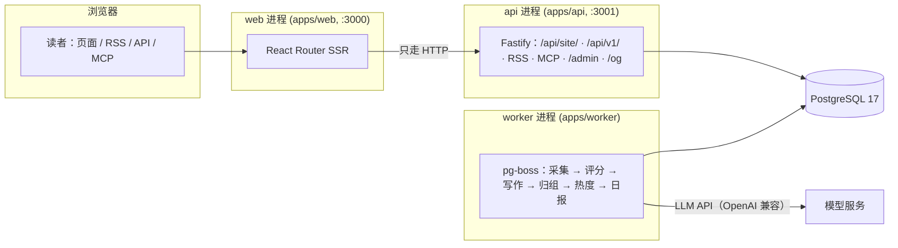

# ARCHITECTURE.md — 框架架构确认（UU AI Hub 新站）

> 编写：陈架（架构）｜日期：2026-10-16
> 对象：AIHOT 开源框架（MIT，github.com/KKKKhazix/AIHOT），本地只读参照 `../ref-aihot/`
> 结论：**框架可直接作为新站骨架**。定制面只有 `site/`（本站身份）＋ `industry/`（行业知识）＋ `modules/`（本站独有功能）；`apps/`、`packages/` 按框架惯例不动（除为新站换品牌色这类最小改动）。

## 1. 技术栈清单

| 层 | 技术 | 版本/说明 |
|---|---|---|
| 语言 | Node.js ＋ TypeScript | Node ≥ 24.11；后端**直接跑 TS，无构建步骤** |
| 网页 | React Router（服务端渲染） | `apps/web`，Vite 构建；只通过 HTTP 读 api |
| 接口 | Fastify | `apps/api`，网站自用 `/api/site/`、公开 `/api/v1/`、RSS、MCP、后台 |
| 任务队列 | pg-boss | `apps/worker`：抓信源、调模型、归组、热度、日报、告警、清理 |
| 数据库 | PostgreSQL | 17；迁移在 `database/migrations/`（模块的表在各自 `migrations/`），按完整文件名排序执行记账 |
| 样式 | Tailwind CSS 4 | 设计 token 在 `apps/web/app/app.css`（语义色＋双主题＋圆角/阴影/动效命名体系） |
| 部署 | Docker Compose | 一键 `docker compose up -d --build`；另有 `deploy/`（Caddy HTTPS） |
| 包管理 | npm workspaces | `packages/*`、`apps/*`、`industry`、`site`、`modules/*` |

## 2. 前后端分工



**铁律（框架 AGENTS.md，逐条遵守）：**

1. 前端只通过 HTTP 读 api；数据库、模型调用、密钥只在后端。
2. 所有公开出口（网页/RSS/API/MCP/站点地图/分享图）都从 `packages/backend/src/publication/` 这一个读取层读。
3. 读者打开页面**不触发模型调用**；模型只在 worker 任务里调用。
4. 付费请求走回执（`providers/receipts.ts`）＋预算熔断，不绕开。
5. 安全阀默认关闭：`COLLECT_ENABLED`、`MODEL_CALLS_ENABLED`、`FEISHU_*`、`INDEXNOW_SUBMIT_ENABLED`，只有显式 `true` 才打开。
6. 公开内容匿名；收藏/已读存浏览器 localStorage；后台仅管理员。
7. 迁移只增不改：已发布的迁移文件不动，修正写新文件；`0055` 起每文件一条在线可执行语句。

## 3. 目录职责（定制面 vs 引擎）

| 目录 | 归属 | 内容 | 新站改动 |
|---|---|---|---|
| `site/` | **本站** | 站名文案 `site.ts`、模型 `models.ts`、品牌 `brand/`、条款 `pages/`、根文件 `public/`、模块清单 `modules/` | ✅ 已换 UU AI Hub 品牌＋原创文案 |
| `industry/` | **本站（行业）** | 分类 `taxonomy.ts`、主题 `topics.json`、示范信源 `sources.json`、提示词 `prompts/`、门槛 `selection.ts` | ⚠️ 暂用 AI 示例包；信源/评分标准待 Allen 按 `docs/customize.md` 定制（不代定） |
| `modules/tools/` | **本站** | 工具导航：`/tools` 页面、`/api/tools` 接口、`tools` 表 | ✅ 新建（本骨架） |
| `apps/`、`packages/` | 引擎 | 网页/API/worker/业务代码/共享类型 | ✅ 不动（仅 `app.css` 换强调色、`og.ts`/`poster.ts` 分享图强调色跟随品牌） |
| `database/` | 引擎 | 迁移（0001–0021） | ✅ 不动 |
| `docs/` | 引擎文档 | customize/deploy/architecture 等 | ✅ 原样保留（MIT），供团队照做 |
| `scripts/`、`tests/`、`deploy/` | 引擎 | 初始化/迁移/评测/部署脚本 | ✅ 不动 |

**上游合并策略**：引擎文件不动 → 将来 `git pull` 上游 AIHOT 更新时，只需解决 `site/`/`industry/`/`modules/` 的冲突（框架的模块插口设计就是为此）。

## 4. 本地启动步骤

```bash
cd new-site
node scripts/init-env.ts --llm-key <你的模型 API Key>   # 生成 .env（DeepSeek 默认；千问/智谱见 .env.example）
docker compose up -d --build
# → http://localhost:3000（前台），/admin（后台，密码在 .env 的 ADMIN_PASSWORD）
```

- 首次启动 `setup` 容器先跑 `node scripts/migrate.ts && node scripts/seed.ts`（建表＋导入示范信源），再起 api/worker/web。
- 不用 Docker 时见 `docs/deploy.md`（Linux/macOS 直接跑三个进程；Windows 用 WSL2）。
- 出刊时间在 `site/site.ts` 的 `EDITION_TIMES`（当前：日报 08:00、周报周一 10:00、月报 1 日 10:30，北京时间）。

## 5. `docker compose` 预演可行性分析（静态，未实际拉起）

> 约束：云电脑无 Docker、无公网入站。本次只做配置静态核验，不启动任何容器/对外服务。

| 检查项 | 结果 |
|---|---|
| `docker-compose.yml` 语法 | 结构完整：`db`（postgres:17-alpine，healthcheck）→ `setup`（迁移＋种子，`service_completed_successfully`）→ `api`/`worker`（:3001，`depends_on setup`）→ `web`（:3000，`depends_on api`）；`caddy` 仅 `https` profile |
| 启动顺序 | setup 保证库表就绪后 api/worker 才起；web 只依赖 api started（SSR 经 HTTP 读 api，库直连不需要） |
| 数据卷 | `db`（PG 数据）、`data`（AIHOT_DATA_DIR）、`caddy` 持久化；重建不丢 |
| worker 停止宽限 | `stop_grace_period: 210s`，避免付费模型调用中途被杀导致重复扣费 |
| 环境变量 | 必填：`SITE_URL`、`ADMIN_PASSWORD`、`SESSION_SECRET`、`IMG_PROXY_SIGN_SECRET`、`POSTGRES_PASSWORD`、`LLM_BASE_URL/KEY/MODEL`；`init-env.ts` 可一键生成 |
| 本站改动兼容性 | compose 仅改名（`aihot`→`uuhub`：project/image/DB 用户名库名）；`modules/tools` 的迁移 `0100_tools.sql` 随 setup 的 `migrate.ts` 自动执行（框架约定：模块迁移与引擎迁移同序执行） |
| 风险点 | ① 首次 `npm ci`＋构建镜像需外网（npmmirror 可解）；② LLM key 缺失则采集/精选不工作，但站点可空跑（安全阀默认关）；③ `scripts/seed.ts` 导入的是 AIHOT 的 18 个示范信源，上线前必须换成 Allen 定的信源（`industry/sources.json`） |

**结论**：compose 配置自洽，预演通过。真正 `up` 的动作留到有 Docker 的机器（Allen 本地或 VPS）上做，由顾部（DevOps）执行。

## 6. 与旧站的关系

- 旧站（AllenShaoMZ/uuaihub，Astro 4）：**只打 P0 安全补丁**，维持到新站上线；其余 quick wins 已全部停止（见 `../BLOCKERS.md`）。
- 新站：基于本骨架重建。数据资产（299 工具＋241 博客）由迁移线灌入：工具 → `tools` 表（本模块），博客/日报 → 引擎的内容管线与 WS5 日报管线。
- 仓库策略：按"新仓库"准备（B10 待 Allen 明早定）；本目录已 `git init` 本地初始化，**未 push、未关联远端**。

## 7. 后续工作（不在本骨架内，已记录）

1. **WS5 日报管线**：`/daily` 路由与引擎已就绪；管线缺 LLM API key（B1）。
2. **首页工具入口区**：WS1 线框要求首页首屏含"工具导航入口区"（分类 chips＋热门 8 款）；骨架阶段 `/tools` 独立成页＋导航＋Tab 已就位，首页入口待 WS2 前端施工。
3. **industry 定制**：信源名单、评分提示词、入选门槛——等 Allen 决策（框架要求不代定），后用 `scripts/eval-selection.ts` 校准。
4. **条款页**：`site/pages/` 为模板，已标"待 Allen 确认"。
5. **SEO**：`/og/pages/tools.png` 分享图走引擎自动生成（CARDS.tools 已配）；`openapi-v1.json` 占位符构建时替换。
6. **VPS 上线**：new-api 中转站＋本 Docker 全栈同机部署（B2，缺公网 VPS）。
